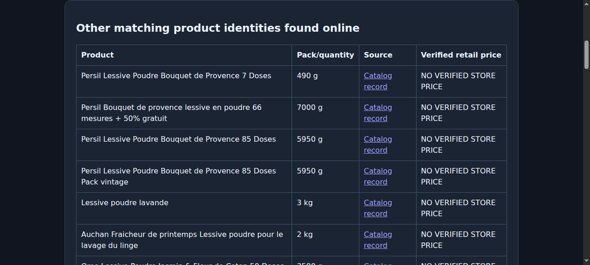
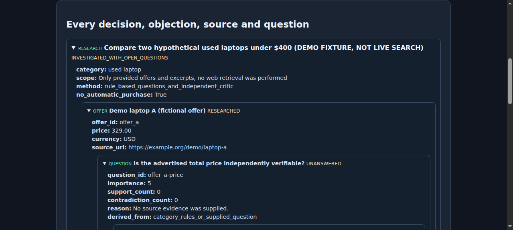
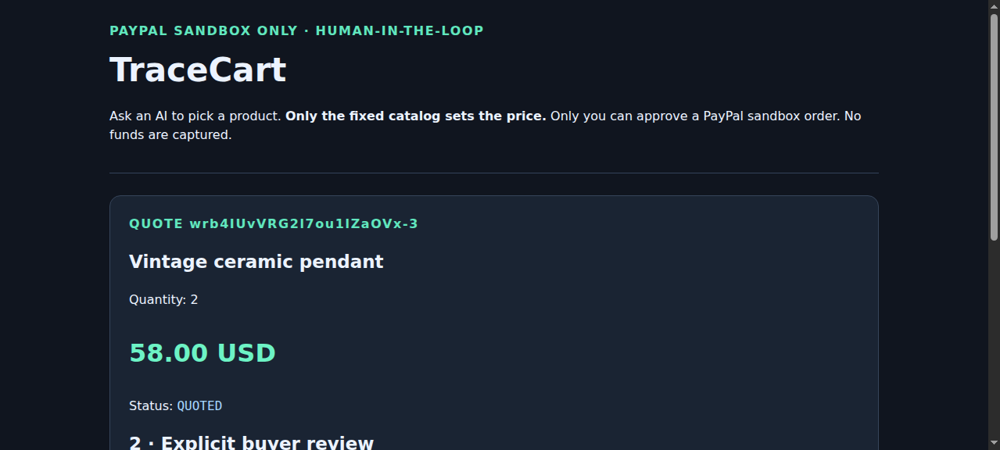

# TraceCart — AI suggestions behind a PayPal consent firewall

**Development status: public MIT-licensed, testable MVP; NOT A CONTEST SUBMISSION.**

**Public source:** https://github.com/issueslinux/tracecart — this repository contains only TraceCart; no private Hunter data or PayPal credentials.
Project for [PayPal AI Hackathon 2026](https://paypalaihackathon.devpost.com/rules), deadline **November 12, 2026, 12:00 p.m. Pacific** (21:00 CET). Entire implementation created after the contest started; no existing TraceCart product reused.

## 2026-11-03: richer central graph with sourced fields and targeted remaining checks

The central SVG now renders saved seller-page data that were previously
absent from the decision projection: SKU/EAN, seller-declared price,
availability and conditional delivery/shipping, plus manufacturer/
merchant technical fields **with their actual source labels and SHA-256**.
Evidence groups connect offer → aspect → page value → downloaded document.
The former 13-source-node display cap and redundant 24-question list
have been removed from the active view. Generic historical probe
catalogues remain labeled as uninvestigated archive in the APIs.

Only *missing, actionable* evidence gaps remain next to each offer.
For the RYOBI RPI18-0 example: instrumented independent test, warranty,
spare parts/repair and real checkout total. The right rail follows
selection and, once all workers terminate, reports **COMPLETE** rather
than continuously rotating old OPEN questions. No publisher claim is
presented as an independently measured specification or checkout price.
[Details, saved RYOBI comparison and test evidence](
docs/EVIDENCE_FIRST_GRAPH_AND_TARGETED_GAPS_2026-11-03.md).

## 2026-11-03: input-first growing graph and fast, honest model statuses

A pasted product URL now appears **first** as a graph node. Its actual
source page is checked and added immediately in an independent I/O lane,
in parallel with catalog and Shopping discovery. Other offers enter the
graph incrementally on **completed source checks** (up to 16 concurrent
network tasks); pending/active offers remain visible in the side task
rail. Exact Product JSON-LD name matching supports marketing titles
that omit a page's explicit model number, without mislabeling it as a
verified checkout SKU.

The previous two synchronous AI stages plus *one per indexed offer*
sequential Qwen calls were removed from the critical path. The new
worker sends at most **one bounded batch** for up to four distinct model
families, marks duplicate/out-of-budget offers explicitly as skipped,
and never shows 18 fabricated simultaneous WRITING cards. SSE events
now have a same-origin snapshot resync path
`/cart/status/<id>/live.json`; orphaned inference statuses are
normalized after restart. Original reports, reference citations,
checkout guardrails and source hashes remain durable.
[Actual RYOBI job measurements and tests](docs/PROGRESSIVE_FIRST_PRODUCT_PARALLEL_RUNTIME_2026-11-03.md).

## 2026-11-03: multi-domain source discovery and discrepancy checks

TraceCart now supports bounded **cross-domain research URL discovery** for
multiple brand/model identities through an explicitly enabled Brave provider
(`BRAVE_API_KEY` + `TRACECART_SOURCE_SEARCH_ENABLED=1`).
The provider has **at most six queries per job** and stores its receipt in
SQLite, so reruns and restarts cannot silently repeat billed requests.
Without both settings no search API call occurs. Index hits become
`source_lead` graph nodes and must pass the existing robot-checked
source/document identity gate before creating a real evidence link.

A general source-comparison engine also checks compatible published
numeric claims in e-bikes, laptops, smartphones, SSDs and compressors:
title-vs-source and source-vs-source differences are labeled as
**unresolved model/measurement discrepancies**, never proof of a
seller's deception, test outcome, exact SKU or checkout price.
The saved AM27 rower analysis now flags its 100 km index title versus
the manufacturer family's 50–85 km *declared* assist range.
[Configuration, provenance and real replay](docs/MULTISOURCE_DISCOVERY_AND_DISCREPANCIES_2026-11-03.md).

## 2026-11-03: general-source investigation for products across categories

The research workers now use a **single robots-aware structured
product-source pipeline**, not individual scrapers for each laptop or
e-bike variant. It discovers URLs from real saved retailer/discovery
links or a visibly confirmed matching brand/model link on a candidate
brand homepage/bounded product sitemap; broad HTML/JSON-LD technical
fields are extracted from six tested category families (with generic
support for other classes). Documented claims get URL, SHA256,
retrieved timestamp, model/variant uncertainty and graph nodes.
Source claims are **not independent laboratory tests** or verified
checkout totals. This remains separate from the existing exact
Lenovo-family Notebookcheck test adapter.

When a publicly permitted source returns HTTP 200 but has no usable
static product data, an optional disposable Chromium in graphical
Xvfb mode may render JS: set
`TRACECART_GRAPHICAL_BROWSER_FALLBACK=1`. One browser at a time,
pinned public-IP DNS and intercepted same-origin HTTPS requests only.
**No bypass of 403, robots.txt, login or CAPTCHA.**
[Generic source and browser design, multi-category tests and live e-bike replay](docs/GENERAL_PRODUCT_SOURCE_RESEARCH_2026-11-03.md).

## 2026-11-03: minimal, live, RAM-backed graph workspace

`/cart` is now the same full-screen interface used by active and completed
research. **One URL input at the top, evolving graph in the middle,
source tasks on the left and changing high-priority questions on the
right.** No marketing hero, decorative process boxes, original bulky
question list or buyer questionnaire in the primary UI.

A same-origin `/cart/status/<id>/live` Server-Sent Events endpoint
streams read-only graph snapshots from a bounded **24-job RAM cache**.
The browser draws an immediate input node and adds offers, evidence
links and verified observations only when persisted work really changes.
An I/O pool checks up to **16 sources/offers concurrently**, with
per-URL fetch de-duplication; local GPU-heavy Qwen question generation
stays separately constrained. Source absence remains visible as missing
source, not a fabricated answer. Original SQLite reports and evidence
remain durable across restart; no browser access to server RAM addresses
or VRAM is exposed. A small SVG network does not require WebGPU.
[Runtime design and verification](docs/LIVE_GRAPH_RAM_WORKSPACE_2026-11-03.md).

## 2026-11-03: interactive offer / claim / source knowledge graph

Every persisted cart decision now has a **read-only interactive evidence
network**: `/cart/status/<job_id>.knowledge-graph.json`, also visualized
above the decision path on the HTML status page. Click any offer to
inspect its individual advertised specifications, indexed price
caveat, high-priority open evidence checks, possible model-identity
leads and any independent source observations; click a shared
specification to see all listings that merely *claim* the same value.
Reference reviews, checked document SHA256, variant mismatch and
source URLs remain distinct from exact-SKU verification. Each
arithmetic Wh value derived from title V×Ah is **per-offer and
unverified**; similar titles never establish a verified common model.
Dynamic SVG pan, zoom, keyboard selection, JSON export and
cross-offer comparison require no external graph database, rendering
dependencies, paid searches or buyer-choice prompts. No checkout
price, quality claim or automatic purchase is inferred.
[Schema, provenance rules, saved e-bike/Lenovo replay and browser verification](docs/OFFER_KNOWLEDGE_GRAPH_2026-11-03.md).

## 2026-11-03: e-bike questions are now source-directed, not 288 formulaic prompts

In the live saved Allegro bicycle example, 288 mechanically repeated
questions per listing were not useful and the local model returned malformed
JSON for two of 13 offers. Electric bicycles now receive **24 distinct
high-priority questions first**, followed by cross-claim and source-specific
checks (**228 questions per offer**), with conditional motor/battery/range
wording based only on what the listing title actually states. The frontend
separates title claims, *possible* model identities from Shopping search
titles, hypothetical battery Wh arithmetic and independently sourced facts.
Qwen proposes up to four shorter questions and retries invalid JSON once.
A source-blocked Allegro page is still not treated as verified and there
are no invented e-bike independent reviews or purchase prices.
[Repair + real browser/Qwen verification](docs/EBIKE_RESEARCH_FIX_2026-11-03.md).

## NEW: actual independent-source checks, not just question lists

**2026-11-02 evidence execution:** A separate nonblocking source worker now
retrieves independently published test pages through robots-aware, public-IP
pinned HTTPS; checks test identity and recorded values; and saves source URL,
SHA-256, retrieval timestamp and **variant scope** per offer. It updates
the matching queued questions without rewriting the original report. First
real supported family: **Lenovo IdeaPad Slim 3 15Q8X10**. Live replay of
the 16-offer Lenovo case produced **2 distinct source measurements**
(708 Cinebench 2024 multi-core; 19h01 WiFi on the reviewed IPS) attached
to two index listings (4 offer-linked references); **zero exact-SKU
verified results**. Intel 16IPH11 and unverified x-kom OLED cannot inherit
those figures. This is a limited first source adapter, not general coverage.
[Source execution, scope limitations and checks](docs/EVIDENCE_EXECUTION_2026-11-02.md).

## NEW: immediate research tree, hundreds of planned source checks per offer

**2026-11-02 later update:** no more blank 10–45 second "Building the research
path" wait. After one URL, the page draws a source investigation node
immediately and receives incremental SQL-backed research stage updates.
For the existing Lenovo example it discovers **16 independent listing leads**
(1 input + 15 index rows) and creates **288 source-check questions per lead**
(**4608 planned investigations**) from a product-specific 24×12 structured
backlog, with paginated loading (24 questions at a time) instead of flooding
the DOM. A separate background local Qwen worker asks additional
offer-specific source questions as they become available; it does not block
the result, browsing or payment safety controls. The structured 4608
are **not claimed to be LLM-written or independently answered**.
Only source-confirmed findings may be marked as answered.
[Full architecture, evidence and real Chromium checks](docs/PROGRESSIVE_OFFER_RESEARCH_2026-11-02.md).

## UPDATE: no-click English research path + real Lenovo source differentiation

**2 November 2026 (supersedes the historical click-to-answer flow below):**
The default /cart and /cart/status/{id} pages now use English and require only
one product URL. The buyer is **never asked to answer the research questions**.
The source/critic tree expands automatically from saved source questions and
a bounded post-index local Qwen question-only pass. A model outage leaves
visible research gaps, not hallucinated answers.

Lenovo 15Q8X10 Snapdragon family OEM specifications, independent Notebookcheck
IPS/60Wh measurement and a separate Intel test are now displayed with explicit
**tested-configuration scope**, not as proof about the submitted x-kom OLED
SKU or indexed 16IPH11 Core Ultra 5 322. No checkout price or automatic
purchase authorization has been established. **Current verification: 375 Python,
8 Node, plus a headless Chromium replay of the saved job.**
[Full evidence, sources, test protocol and outstanding contest gates](docs/AUTONOMOUS_EVIDENCE_2026-11-02.md).

## CURRENT STATUS / NEW-CHAT HANDOFF (2026-11-02)

**Start here for current architecture, audited Shopping counts, demo,
security constraints and the next research milestone:**
[Project handoff](docs/PROJECT_HANDOFF_2026-11-02.md)
· [Copy/paste prompt for a new chat](docs/NEW_CHAT_START_PROMPT_2026-11-02.md).

As verified on the local host on 2 November, the merged interactive
decision-tree UI is running at **http://127.0.0.1:8781/cart**.
Historical Lenovo report: /cart/status/w8MOeW8uE7pCqDYKf48-lXxy.
The Shopping index provided **12 cards + 3 indexed seller links**,
but **zero confirmed checkout prices**; the original x-kom price
was not retrievable. No live PayPal Sandbox end-to-end approval,
public judge-accessible deployment, video or Devpost submission
has been confirmed. The source report and hash remain unchanged.

## HISTORICAL: earlier interactive buyer decision explorer (superseded)

The earlier cart workflow used a click-to-answer decision tree. That
implementation has now been superseded by the autonomous English research
path described above. The retained historical example screenshots and
comments below describe the previous implementation. The complete old research
audit remains available at /cart/status/{id}/audit; raw report JSON remains
unchanged and its original hash stays intact.

**Real Lenovo correction:** the existing x-kom laptop job had an OPF
catalog count of zero but **12 Google Shopping cards, 3 indexed seller
links and 4 title-level comparable alternative configurations**. The
sidebar now shows those separate counts. The original x-kom item price
remains unknown because the retailer page exceeded the bounded reader.
Snapdragon ARM and Intel x86 are treated as distinct compatibility
choices. No index quote is promoted to a verified seller/checkout price.

[Design, source evidence, conditional decisions and real-browser checks](docs/INTERACTIVE_DECISION_TREE_2026-11-02.md).

## NEW: comparable alternatives, not only identical SKUs (2026-11-02)

TraceCart now presents a separate **similar functional/price-tier** shortlist
beside strict same-SKU comparisons. Different brands and models are eligible:
for e-bikes, it compares indexed motor power, battery Ah/nominal Wh when known,
wheel size, gears, assist speed and advertised range. Unknown specs remain
explicit. Alternative ranking distinguishes close specifications, partial
matches, different technical tiers and different categories; severe capacity
and power differences are not treated as equivalents.

Price bands use the selected listing price when available or a clearly marked
median of sufficiently similar indexed results, not an invented purchase total.
The 12-card real Allegro bicycle test produced **six close technical
alternatives** and **four possible alternatives needing more data**. The
index-only results do not prove actual ride quality or current checkout prices.

[Technical design, real bike results, assumptions and missing evidence](docs/SIMILAR_PRODUCT_TIER_2026-11-02.md).

## FIX: Allegro bicycle Shopping cards survive Google Product detail errors

On **2 November 2026**, the user submitted a specific Allegro 250W/15Ah
electric-bike link (offer 18482612668). The original Shopping query
returned 40 actual indexed search cards, but the follow-up Product
details API failed. Previously, one detail failure erased all results.
The UI now preserves 12 bounded Shopping card prices and Google
Shopping search links in the full tree, explicitly marked **unverified**.

In an actual URL-first app test, **12 cards appeared** (including Allegro
indexed leads at **2469.00–2469.05 PLN**), despite the original Allegro
HTTP 403 and detail-API failure. These cards are **not the same as**
a confirmed price for the submitted listing: its independently indexed
public Allegro offer page showed **2649 PLN**, with EAN 0746121153095.
No product-equivalence or checkout savings claim is made.

[Full reproducible case and real Shopping result snapshot](docs/ALLEGRO_BIKE_SHOPPING_FALLBACK_2026-11-02.md).

## Real Google Shopping Search-First test: 20 products (2026-11-02)

Using a locally configured SerpApi Free-plan key, the project completed a
**genuine 20-product Google Shopping test**. Search index data returned
58 seller price records across 17 products; direct Allegro-indexed links were
found for **12/20** cases. Two product queries failed at the provider level
and one additional case had only search-card prices. Neither a clickable link
nor a low indexed price proves seller availability or checkout cost.

Important quality finding: iPhone 16 at **349.90 PLN** and Garmin Forerunner
265 at **48.79 PLN** are highly anomalous compared with other indexed prices.
The comparator now flags extreme low outliers and model/capacity/bundle conflicts
and excludes them from its provisional minimum without deleting evidence.
Five direct retailer spot checks retrieved only one page, whose price matched
the index; the other four returned HTTP 403/404.

**SerpApi reported degraded/poisoned Shopping results on this same date.**
[Full results, limitations, source checks and reproduction](docs/SERPAPI_LIVE_20_RESULTS_2026-11-02.md).

## NEW: Search-First indexed marketplace prices from Google Shopping

TraceCart's URL-first cart job now supports official SerpApi Google Shopping
and Google Product-store queries when SERPAPI_API_KEY is configured on
the project host. Search-indexed seller prices, URLs, currencies and
conditions are shown in the UI and evidence tree even if a marketplace's
direct product HTML returns HTTP 403. Google-indexed prices are NOT
verified seller-page prices, exact GTIN matches, or checkout savings.

DataForSEO is available as a separate explicitly authorized, paid,
asynchronous research adapter. The 20-product evaluation protocol is
implemented; without keys the preview reports zero live provider calls,
rather than fabricating coverage results.

**Historical feasibility status earlier on 2 November (before the
SerpApi key was configured):** initially neither provider key was
configured and no live comparisons had completed. **This statement
is no longer current.** A subsequent actual 20-product SerpApi
test is documented above. Indexed prices from that test do not
verify checkout prices. DataForSEO remains a separate paid adapter.

[Search-First implementation and 20-product benchmark](docs/SEARCH_FIRST_PROVIDER_FEASIBILITY_2026-11-02.md)
· [Provider availability audit](examples/search_first_20_protocol_2026-11-02.json).

## P0: marketplace access is a hard product blocker (not solved)

The server cannot reliably retrieve major marketplace product pages:
Allegro returns **HTTP 403**. Allegro no longer grants new applications
market-wide offer-search API access (see developer confirmations).
**A price assistant that ignores Allegro cannot claim to search the market.**

A *feasibility-only* Chrome/Chromium extension under
[`browser-extension/`](browser-extension/) now lets the **user manually
capture one open browser product tab** and paste a small price observation
into TraceCart. This is not unattended marketplace research, not a new
Allegro API and not yet validated against the real Allegro browser UI.
It carries the lowest `USER_BROWSER_ACTIVE_TAB_NOT_SERVER_VERIFIED`
evidence tier and never bypasses a HTTP 403.

[Feasibility gate, installation and limits](docs/MARKETPLACE_BROWSER_CAPTURE_FEASIBILITY.md) ·
[Blocking issue #38](https://github.com/issueslinux/tracecart/issues/38).

## Search-first provider quality audit (offline replay)

A bounded 20-product SerpApi/DataForSEO study can now be replayed from
actual saved API JSON without incurring new queries. It measures model-token
matched indexed price observations, marketplaces and retailer-link coverage,
separating pending/missing provider responses from no usable matches.
Until real provider responses are supplied, coverage remains **NOT MEASURED**.
[Offline provider audit instructions](benchmarks/SEARCH_FIRST_OFFLINE_AUDIT.md).

## NEW: automatic competing-offer source checks from authorized search

With `BRAVE_API_KEY` configured, the URL-first cart job now runs two
bounded official Brave Web Search API queries: a general seller search and
a specific Allegro marketplace discovery query. Search snippets remain
UNVERIFIED. The engine chooses at most three distinct merchant URLs and
runs the existing HTTPS/robots-aware source parser and strict equivalence
gates against the selected product. A blocked Allegro listing is retained
as a discovery lead in the full report; it is never silently discarded.

An actual five-result Stanley Air Kit research sample was **manually seeded
from public search results** because no Brave key was configured on the
project host. Live source checks retrieved two seller pages, confirmed
one comparable seller-listed price (Narzedzia.pl 367.99 PLN), and retained
an Allegro HTTP 403 lead. This was NOT an automatic Brave search run,
a market-wide lowest-price claim or a validated checkout total.
[Method and live-source evidence](docs/AUTOMATIC_OFFER_DISCOVERY_2026-11-02.md).

## NEW: keep cheaper marketplace leads visible despite HTTP 403

A blocked retailer URL may still represent the most interesting price lead.
The cart comparison accepts an optional user-observed marketplace URL and
price and keeps it as explicitly UNVERIFIED evidence, even if safe retrieval
returns HTTP 403. The interface and full decision tree retain the link,
price observation, audit trail, research questions and any price conflicts.

On 2 November 2026, Stanley Air Kit Allegro offer 18637535530 was observed
at **229.00 PLN** (previously **265.00 PLN**); two directly fetched sellers
showed **382.28 PLN** and **490.14 PLN**. These are different evidence tiers,
NOT verified checkout savings or a complete market ranking.
[Method, limitations and real source audit](docs/MARKETPLACE_PRICE_LEADS_2026-11-02.md).

## NEW: evidence-driven Offer Research Critic

Once seller-page comparisons finish, TraceCart now creates an **actionable
research critique** in both the page and complete exported decision tree.
It identifies promising *seller-listed* price leads without forcing a purchase
winner, records failed evidence gates, prioritizes follow-up questions and
preserves deferred research branches. No independent review or lab test is
invented. A new two-merchant Stanley Air Kit observation produced one
**107.86 PLN lower-listed-product-price research lead** (xDom baseline versus
Fabryka Narzędzi), not a verified checkout saving.
[How it works and source evidence](docs/OFFER_RESEARCH_CRITIC.md).

## NEW: real Stanley Air Kit same-EAN offer comparison + transport evidence

On **2 November 2026**, TraceCart directly retrieved two in-stock seller
pages for **Stanley Air Kit / EAN 8016738753899**: Fabryka Narzędzi
**382.28 PLN** and xDom **490.14 PLN**. A narrowly scoped HTML EAN parser
unlocked this comparison; source timestamps and SHA-256 are preserved.
Public product pages also declare courier shipping of **26.00 PLN** for
Fabryka and shipping of **17.99 PLN** (method unspecified) for xDom.
The resulting **conditional** product + shipping figures are **408.28 PLN**
and **508.13 PLN**. These are NOT verified checkout totals; eligibility,
destination, payment fees, condition and actual delivery time remain unknown.

Cart questions are now grouped into **product, offer, seller, delivery,
payment and total cost**. `/compare` optionally accepts source-declared
shipping and ETA evidence, keeps unknowns explicit and never forces a
purchase decision. **Shipping is not yet automatically extracted by
TraceCart.** [Full method and constraints](docs/TRANSPORT_AND_PURCHASE_STAGES_2026-11-02.md) ·
[Live source evidence](examples/live_stanley_two_shop_2026-11-02.json).

## Source-qualified sale prices: live MAXPRONET Persil result (2 Nov 2026)

TraceCart now understands an individual Product JSON-LD Offer with both
`ListPrice` and `SalePrice`: it chooses the **seller-declared sale price**,
never the crossed-out reference price. On the actual MAXPRONET Persil Color
4.5 kg / 75 washes product page, the public HTML declared **78.90 PLN
SalePrice** and **153.99 PLN ListPrice**. The source-qualified unit cost is
**1.0520 PLN per declared wash**. The source was fetched after robots.txt
preflight, and its timestamp, page SHA-256 and method are preserved. GTIN,
delivery and final checkout amount remain unverified, so no cross-store
savings are asserted. See
[method and limitations](docs/LIVE_SALE_PRICE_SPEC.md) and
[actual source snapshot](examples/live_maxpronet_sale_spec_2026-11-02.json).

## NEW: check a second real store offer before checkout

After submitting the selected product URL in `/cart` and receiving the
initial analysis, paste an optional **second retailer product URL** into the
new comparison form. TraceCart safely retrieves that seller page under the
same robots.txt/public-HTTPS restrictions, preserves exact source
provenance, displays both source-declared prices and cost per wash when
available, and exports the complete augmented evidence/critic tree.
A seller-listed percentage difference is calculated **only** if both
pages were retrieved and declared matching GTIN, compatible wash counts,
prices and currency. No delivery or checkout-total verification is implied.

**Real 2 November 2026 observation:** Amazon Ariel Color 100 washes:
76.99 PLN (snapshot from 1 November), Granes Ariel **Professional** Color
100 washes: 87.99 PLN (newly retrieved page and JSON-LD). **No comparable
savings claim:** Amazon did not disclose GTIN and the Professional variant
may differ. The earlier search-indexed 94.99 PLN for Granes was not
current in its downloaded HTML, demonstrating why snippets are inadequate.
[Complete live report](examples/live_amazon_vs_granes_2026-11-02.json) ·
[method, source attempts and limitations](docs/LIVE_SECOND_OFFER.md).

## Store-agnostic product URL intake — real Amazon + fallback validation

**Default process is universal**, not a custom Amazon, Allegro or Adafruit
scraper. Paste a product URL into `/cart`. TraceCart removes tracking
parameters, validates a public HTTPS destination, checks robots policy
and fetches the page with TLS + pinned public DNS. Safe same-host HTTP
redirects (max two) are supported. When accessible, real Product JSON-LD
or OpenGraph provides a title, seller price/currency, GTIN and stock claim.
The category model and evidence research run in the background.

If page access is blocked or metadata cannot be parsed, TraceCart uses
**a generic, explicitly unverified URL-only identity** for any public
HTTPS domain with a useful path. All unknown price/stock/GTIN fields
remain unknown; no fake verified offers or bypasses. The user gets
a useful partial analysis, or a clear 'identity not established' status
if the URL has only an opaque code. [Architecture and limitations]
(docs/STORE_AGNOSTIC_URL_INTAKE.md).

**Actual live Amazon result (2026-11-01):** the original lengthy
`https://www.amazon.pl/.../dp/B0FNPZQKMF/ref=sr_1_6?... ` link
first returned HTTP 301. The generic URL sanitizer removed the
tracking suffix; the product page was then successfully retrieved:
`Ariel Proszek do prania Color, 5.5kg, 100 prań`, seller-claimed
**76.99 PLN**, `InStock`; no EAN was published. Its full trace and
page evidence are saved in
[the historical Amazon report](examples/live_amazon_ariel_url_only_2026-11-01.json).
Despite that filename, this actual example used downloaded JSON-LD,
not URL-only recovery. Eight catalog alternatives were discovered;
**no competing retailer prices were verified**.

This is a robust, domain-neutral **best-effort** intake, not a promise
to extract every product on the internet. Authentication, site access
restrictions, missing metadata or JavaScript-only data can require
authorized merchant APIs. No checkout authorization is delegated to
research.

## Allegro product pages: explicit HTTP 403 handling

Allegro may return HTTP **403** when TraceCart tries to retrieve product
HTML. The application now **continues limited research** for validated
`allegro.pl/produkt/<slug>-<UUID>` product links using only the title
words and offer ID **already visible in the user's URL**. It deliberately
does **not** claim to have downloaded the blocked page, does not attempt
to evade Allegro's protection, and does **not** invent its price, EAN,
stock, shipping cost or actual product characteristics.

The report clearly marks `URL_ONLY_UNVERIFIED`, the HTTP_403 cause,
unknown price, and links to the original offer. The full source/critic
tree still runs and can be exported. For actual retail price checking,
an authorized Allegro source or another permitted feed is required.

**Real regression:** the user-provided Persil Color Pulver 4.5 kg /
75 washes Allegro URL, containing offer ID `18675491436`, now
finishes as **READY with limited identification** instead of FAILED;
all other claims remain unverified. The existing FAILED job from
an old app version must be retried with a new submission.

[Exact Allegro limitations and developer notes](docs/ALLEGRO_URL_FALLBACK.md) ·
[Archived example research JSON](examples/allegro_403_url_only_2026-11-01.json)

## URL FIRST — paste a product link, no manual product fields

**Changed intake as requested:** the first step at
[http://127.0.0.1:8781/cart](http://127.0.0.1:8781/cart) (current
local instance; earlier tests used port 8771) is now only
**the URL of the selected product**. TraceCart visits that page using
public-IP-pinned HTTPS, verifies the page's robots.txt before fetching,
refuses redirects, and extracts its actual Product JSON-LD (or limited
OpenGraph/HTML fallback): title, seller-declared price/currency, EAN if
present, and availability/brand when disclosed. Original seller claims
are identified with the page URL, retrieval date and SHA-256. No invented
price or barcode when a website does not publish them.

The URL immediately creates a **background research job** that first
extracts the product and then selects appropriate evidence questions,
searches online sources and builds the complete comparative/critic tree.
The source card appears at the top of the pre-checkout report.
**A product link is not a purchase instruction and never approves payment.**

The server-side endpoint also accepts an authenticated JSON event
`{"product_url":"https://www.adafruit.com/product/1083"}` on
`POST /api/cart/added` (requires
`TRACECART_CART_WEBHOOK_TOKEN` configured on the trusted backend).
Older backend events that already contain validated title/price/EAN
remain supported. This interface is still a standalone localhost demo,
not an installed WooCommerce integration.

**Actual live demonstration 2026-11-01:** submitted
https://www.adafruit.com/product/1083 as the *only* form value.
The page yielded product name "ADS1015 12-Bit ADC - 4 Channel with
Programmable Gain Amplifier", source-listed USD 9.95, InStock claim;
barcode was not published. The form returned in 0.01s and the job
completed with 13 source/model questions and a saved trace. No verified
other-shop price comparison was possible. Price and availability are
retailer statements, not an actual purchased transaction.
[Archived complete report](examples/live_url_adafruit_2026-11-01.json) ·
[Real Chromium screenshot](media/url-first-adafruit-live-browser.png).

**Security and limits:** public HTTPS domain + pinned public DNS
addresses, robots.txt preflight, hard response-size caps, HTTPS certificate
verification, no cross-domain redirects, no private IP targets, no cookies,
credentials or JavaScript execution. Works only on accessible pages with
enough extractable metadata; blocked/JS-only stores need an authorized
commerce API or connector. Missing price is `null`, not 0.00.

## New workflow: automatic research after the item enters the cart

The shopper has **already chosen a product**. When the merchant records
"Add to Cart", TraceCart can accept its details in a local background job and
prepare an evidence-based comparison before checkout. Its job is to show
alternatives, differences, missing evidence and critic questions, not force
a buyer into a different product or trigger a payment.

**Run the demo:** `python3 app.py --port 8770`, then open
[http://127.0.0.1:8770/cart](http://127.0.0.1:8770/cart).
The sample cart input is ILLUSTRATIVE. The research job, by contrast,
actually searches **Open Products Facts** for similar and cross-brand
products and tries **Open Prices** historical prices for a selected EAN;
both outcomes are preserved. The local Qwen model (when available) proposes
additional questions about sources. Public product catalog entries are NOT
shop offers. Without verified competing store prices, the UI states that
zero competing offers were price-verified and never claims imaginary savings.

**Store integration interface:** authorized server-side
`POST /api/cart/added` with `X-TraceCart-Event-Token`, configured using
`TRACECART_CART_WEBHOOK_TOKEN`; responds immediately with HTTP 202 and a
job/status ID. Product data only; no buyer details or payment instructions.
Results persist in SQLite and export as a complete evidence/critic JSON tree.
The sample server remains loopback-only and **is not yet wired to WooCommerce
or any real remote checkout**. See
[full cart-hook integration and data limitations](docs/CART_TRIGGERED_RESEARCH.md).

If `BRAVE_API_KEY` is configured, a bounded public web-search request
attempts discovery of competitor-store links. Search links/snippets remain
UNVERIFIED until actual merchant offers, prices and stock can be confirmed.
Brave requires an authorized API key; without one the step is reported
`SKIPPED_NO_API_KEY`, not silently presented as success.

**Source attribution:** Open Products Facts / Open Prices are external
community databases. Original application code is MIT-licensed;
[external data attribution and licensing](examples/DATA_SOURCES.md)
are separate. The captured snapshot below is historical, not live prices.



[Observed source-linked cart report (historical snapshot)](examples/live_cart_persil_2026-11-01.json)

## NEW: conditional comparisons instead of a forced purchase verdict

**Product direction:** TraceCart is a comparative purchasing analyst, not a
machine that insists on choosing a winner. Offer A may be cheaper; B can have
higher advertised specs whose usefulness is unknown; C may be used and cheaper
but need seller confirmation about repairs, condition, battery and returns.
The buyer sees the trade-offs first, then the **complete evidence/critic tree**.

Open **http://127.0.0.1:8765/compare** after starting the local app. It accepts
structured offers, price, currency, condition, comparable specifications and
source URLs. It computes price deltas with an explicit denominator and
identifies missing specs; no spurious overall quality score is produced.
The comparator's final status is **NO_FORCED_WINNER**, not a forced abstention
from useful comparative analysis. The full traceable decision tree remains
available below and as a JSON export. PayPal checkout remains unrelated and
requires explicit human approval.

View the **FICTIONAL illustrative example**:
- [Three offers, original hypothetical inputs](examples/comparison_three_laptops_FICTIONAL.json)
- [Full expandable comparative report](examples/comparison_three_laptops_FICTIONAL.html)
- [Full comparative JSON audit](examples/comparison_three_laptops_FICTIONAL_report.json)
- [Chromium screenshot](media/comparison-conditional-real-browser.png)
- [Permanent product direction / next milestones](docs/DECISION_SUPPORT_VISION.md)

These sample offers use reserved example domains and are not current retailer
listings, independently measured performance, verified user needs or real
seller statements. The next step is feeding **actually comparable real offers**
and their evidence into this presentation, not polishing isolated SHT40 spec checks.

## Two-publisher product specification cross-check (2026-11-01)

**New evidence source beyond the retailer:** TraceCart now reads the official
[Sensirion SHT40 chip specification](https://sensirion.com/products/catalog/SHT40)
and compares it with the actual
[Adafruit SHT40 breakout listing](https://www.adafruit.com/product/4885).
The cross-check is invoked via **/research → Cross-check SHT40 against Sensirion**.
Two separate URLs have fixed HTTPS domains, robots.txt checks, no redirects, size
and timeout limits, and page SHA-256 + retrieval timestamp provenance. The
merchant Product/Offer JSON-LD determines **current** price/stock; Sensirion is
technical documentation, **not a seller offering the same breakout board**.

Verified actual values on 2026-11-01:
- Typical SHT40 chip relative-humidity accuracy: retailer **1.8 %RH**, OEM **1.8 %RH**.
- Typical SHT40 chip temperature accuracy: retailer **0.2 °C**, OEM **0.2 °C**.
- The merchant listed the assembled breakout for **USD 5.95** at capture time.

Both sources are distinct **publishers of nominal component specifications**,
NOT independent lab tests or reviews. Their numerical agreement corroborates
the documentation values only; it does not measure this specific board, verify
power/regulator behavior or certify a unit. The critic explicitly opens follow-up
questions about the finished board and its measurements and the decision remains
**ABSTAIN** until important unknowns are resolved. If the two documents
disagree, the criterion becomes **CONFLICTED** and the critic objects.

Reproducible source-linked example:
- [Complete actual two-publisher decision tree (offline HTML)](examples/live_sht40_two_publishers_2026-11-01.html)
- [Full signed-by-hash analysis JSON](examples/live_sht40_two_publishers_2026-11-01.json)
- [Real source input snapshot](examples/live_sht40_two_publishers_2026-11-01_input.json)
- [Screenshot from actual browser](media/live-sht40-oem-crosscheck-browser.png)

Scope remains deliberately limited: this is **not** yet broad autonomous review
search, an independent comparative product test, measured reliability or a
validated decision-rank model. Real PayPal Sandbox credentials and a Devpost
submission are also still pending.

## LIVE offer source collector — first verified merchant integration (2026-11-01)

The /research interface now offers two paths: import previously collected
offers/reviews as JSON, or **fetch live product pages directly** from the
explicitly allowlisted merchant Adafruit. Enter 1–5 full HTTPS product URLs,
one per line. This is a concrete external data integration, not a fabricated
example. The connector is **not a general web search engine yet**.

**Technical safeguards:** Python standard-library HTML/JSON-LD Product/Offer
extraction, robots.txt preflight, non-public host rejection, strict Adafruit
product URL allowlist, HTTP redirect refusal, timeout/response-size caps, a
minimum 2-second spacing between product fetches, and no login or authentication.
Sources retain the original link, retrieval timestamp, publisher domain, source
type, SHA-256 of the exact downloaded page bytes and the extracted field.

**Evidence discipline:** listed price, stock and declared condition are
**merchant assertions**, not independently confirmed facts. Multiple URLs at
one publisher do not count as independent corroboration. External customer
reviews and third-party tests **are not collected** in this initial connector
(and are counted as zero in its reports). The separate deterministic critic
runs on every result; the optional local Qwen researcher and critic can propose
new **open questions** about these real source records, not facts or payments.
Every failed fetch is visible in the full tree and source report. We never
silently replace missing sources with model text. With unresolved claims the
final recommendation remains **ABSTAIN**, and no payment can be authorized
from the report.

**Live-verified historical example:** On 2026-11-01 the collector read real
Adafruit pages for ADS1015 (1083, merchant price USD 9.95, InStock),
SHT40 (4885, USD 5.95, InStock), and Raspberry Pi Zero W (3400,
USD 15.00, OutOfStock). These items are different products; do **not**
interpret the three prices as directly comparable purchase alternatives.
Prices and availability may have changed since that snapshot.

- [Offline expandable full tree from actual source retrieval](examples/live_adafruit_2026-11-01.html)
- [Audited live tree JSON with provenance and final abstention](examples/live_adafruit_2026-11-01.json)
- [Actual external evidence input JSON](examples/live_adafruit_2026-11-01_input.json)
- [Real Chromium screenshot of source-linked tree](media/live-merchant-evidence-browser.png)

The local full workflow was verified with 3 real HTTP fetches, 9 extracted
merchant claims, an expandable 68-branch report, a persistent JSON download,
and a final ABSTAIN. **No reviews, independent testing, ranking calibration,
payment or hackathon submission was completed in this step.**

## Evidence Critic and Complete Decision Tree (experimental)

TraceCart now builds a transparent, expandable decision tree from supplied
search results, product listings, reviews and test excerpts. Users are not asked
dozens of questions: the analysis questions target the OFFERS and EVIDENCE.

The researcher proposes new investigations. The independent critic challenges
unsupported or contradictory interpretations. A deterministic critic always
flags missing sources, single-source assertions, contradictory excerpts and
remaining evidence gaps. Local Qwen can optionally generate further questions
in two separate researcher/critic passes. AI proposals are OPEN QUESTIONS,
never trusted answers. Duplicate and over-budget proposals are documented in
the tree audit. The engine does not use source counts as an automatic quality
score and abstains when material evidence remains uncertain.

After analysis, the user can inspect EVERY tree branch, including each offer,
question, evidence URL and excerpt, critic objection, proposed follow-up and
final decision. Reports persist locally across restarts and export as complete
JSON snapshots with a SHA-256 digest.

Run the local app (python3 app.py --port 8765) and open
http://127.0.0.1:8765/research . Paste source data as JSON or start from the
clearly FICTIONAL demo fixture. Enable optional AI-generated follow-ups if
Ollama is running. Review the expandable results; click Export complete JSON.

Artifacts:
- [Fictional example input](examples/sample_research_fixture.json)
- [Full example decision-tree JSON](examples/sample_decision_tree.json)
- [Standalone offline expandable HTML](examples/sample_decision_tree.html)
- [Real-browser view of the tree](media/tracecart-critic-tree-browser.png)



CURRENT LIMITATION: This module does NOT yet discover or search across
arbitrary marketplaces or review sites. The new connector only fetches explicitly
specified product URLs from one supported merchant.
The sample offers and reviews use reserved example domains and are not real
product evidence. Automated source collection, publisher deduplication,
independent source verification and calibrated multi-criteria rankings remain
future milestones. The decision report is informational and cannot authorize
or trigger a PayPal order.


## The problem

AI-assisted checkout is dangerous when a natural-language model can hallucinate prices, quantities or buyer consent. TraceCart separates those powers: a small local Qwen model can only suggest a catalog SKU and a bounded quantity, while trusted Python code derives the exact payable amount from a server-controlled catalog and requires an explicit, short-lived human approval before calling the **PayPal Sandbox Orders v2 API**. It never captures payments. Network uncertainty is reconciled manually instead of retrying blindly.

## Current end-to-end paths

- Natural-language request → **real** local Ollama inference → schema validation → server-side catalog price → persisted quote.
- Explicit human approval requires typing `I APPROVE SANDBOX CHECKOUT` **and** the exact USD amount. AI cannot approve or set arbitrary price.
- Approved quote → OAuth 2.0 token `/v1/oauth2/token` → `POST /v2/checkout/orders` using `PayPal-Request-Id`. **Fixed sandbox host:** `https://api-m.sandbox.paypal.com`.
- PayPal sandbox response is validated, including `https://www.sandbox.paypal.com` payer approval URL. State becomes `PAYER_ACTION_REQUIRED`; **no capture route exists**.
- A failed OAuth preflight leaves the approved quote safely retryable; no order API call is made. A timeout, crash, or unknown response after the create attempt → persistent `CREATE_UNCERTAIN` requiring **manual READ-ONLY GET** reconciliation by sandbox order ID, never another POST to avoid duplicates.
- Structured local audit journal for quote creation, explicit consent and request outcome. No credentials or request tokens in the journal.
- PayPal Orders API responses are rejected unless they echo the exact server-approved reference, USD currency and amount. Sandbox approval links must match the returned order ID and authorized host; HTTP redirects carrying secrets are disallowed.
- UI defends against cross-origin forms, CSRF and DNS-rebinding Host headers; runs loopback only.

## Running locally

Prerequisite: Python 3.8+; no dependencies beyond the standard library. Local Ollama at `http://127.0.0.1:11435` (alternatively `11434`) with model `qwen2.5:1.5b-instruct`. `core.py` supports local model parsing, while `app.py` binds to **127.0.0.1 only**.

```bash
git clone https://github.com/issueslinux/tracecart.git
cd tracecart
python3 -m unittest discover -s tests -v
python3 app.py --port 8765
# On that same machine: http://127.0.0.1:8765
```

PayPal **sandbox** credential provisioning (once an authorized developer account exists):

```bash
export PAYPAL_CLIENT_ID=...         # sandbox REST app client ID
export PAYPAL_CLIENT_SECRET=...     # sandbox REST app secret; do not commit
python3 app.py --port 8765
```

The application has **no live PayPal switch**. Credentials must be for a sandbox app; `PAYPAL_CLIENT_ID` and `PAYPAL_CLIENT_SECRET` are unset on the testing host. Do not disclose them in repo or demo. For a successful sandbox checkout, a payer uses the PayPal-provided approval URL; no sandbox payment has been created or approved in this implementation yet.

## Recorded checks — Nov 1, 2026

- Python stdlib `unittest`: **20 PASS**, including LLM price injection, exact amount consent, quote expiry, no duplicates after timeout, read-only reconciliation, OAuth contract, exact PayPal amount/reference checks, blocked live redirects, CSRF, hostile Origin/Host and complete loopback HTTP flow against an in-memory fake PayPal gateway. **No fake response is reported as a real PayPal transaction.**
- Actual local Qwen inference with `I would like two vintage ceramic pendants, please`: returned `ceramic-pendant`, quantity 2, server-priced USD **58.00**.
- Adversarial prompt asking for a cent-priced charge without confirmation: model returned an invalid selection, **fail-closed** as a `ValueError`; no quote, approval or payment.
- `python3 -m py_compile core.py app.py` passes; `GET /` on the local web UI returned HTTP **200**.
- End-to-end real-browser **Chromium + local Qwen → consent review** PASS: natural-language request for two pendants generated a server-priced quote of **58.00 USD**, shown with the real `QUOTED` state; screenshot below. A same-origin POST issue in the initial UI was found and corrected by using `Referrer-Policy: same-origin` while retaining strict `Origin` and CSRF checks. No approval or sandbox order was placed by the browser run.
- **Not yet verified:** *real* PayPal Sandbox OAuth/order creation, buyer approval, deployed judge-accessible instance, external model quality metrics, <3-minute video with professional narrator, YouTube upload or Devpost submission.

## References and constraints

- [PayPal Checkout Standard back-end integration](https://developer.paypal.com/platforms/checkout/standard/integrate): server creates an order, payer approves it, server optionally captures later. TraceCart deliberately stops before capture.
- [Official hackathon rules](https://paypalaihackathon.devpost.com/rules): PayPal sandbox + AI must both be central; source must be publicly available under an OSS license, demo actually runnable, and the competition requires a **public YouTube** demonstration video under three minutes. This public repository fulfills the source-availability step; it does **not** substitute for an authenticated PayPal Sandbox transaction, video or Devpost submission.
- All files in this standalone TraceCart project are provided under the [MIT license](LICENSE). No owner credentials are included.
- The three catalog items and user prompts are test examples, not market demand data. Validation under real inputs and additional differentiating capabilities are necessary before calling TraceCart an innovative contest entry.

### Real-browser screenshot (real Qwen quote, no payment)



## Next concrete milestone

Provision an authorized PayPal sandbox REST app, execute OAuth → create order → buyer approval in a test account, build a logged and repeatable UI journey, test timeout/duplicate and amount integrity, then produce a professionally narrated real-browser YouTube demonstration under three minutes, with only verified functionality, and complete the owner-approved Devpost entry. Only the owner may approve account registration, personal terms, account creation and final Devpost submission.

**Never use live payments or create unauthorized transactions.**
