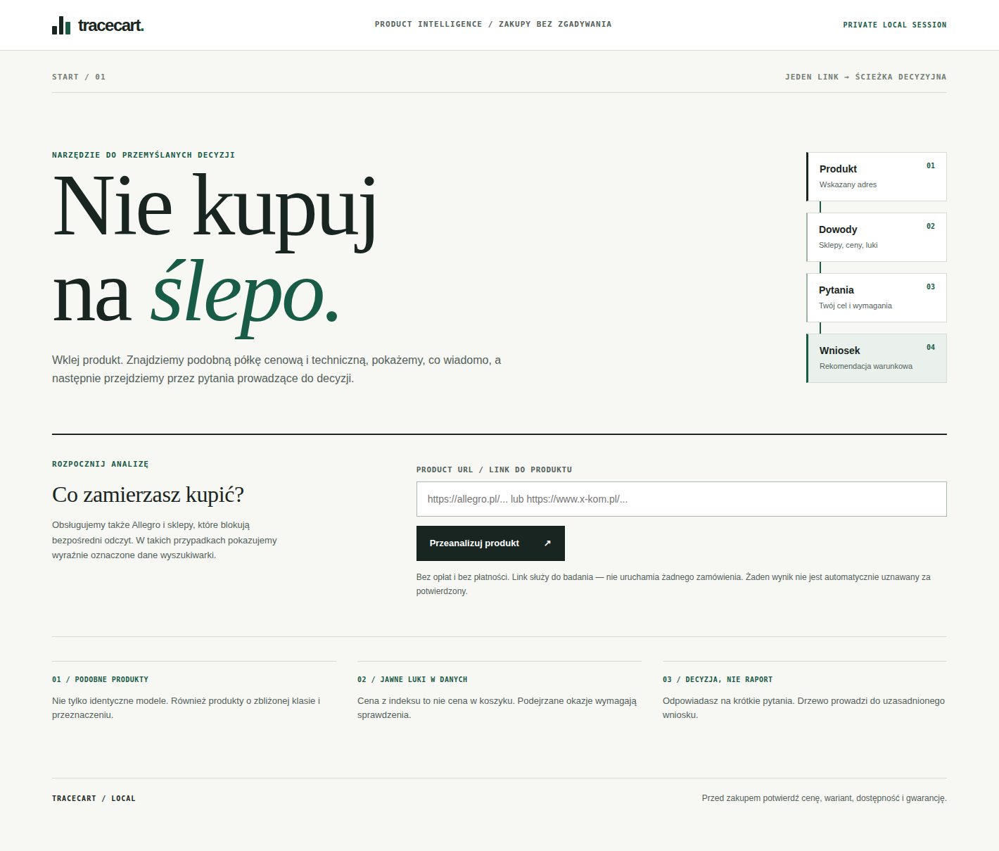
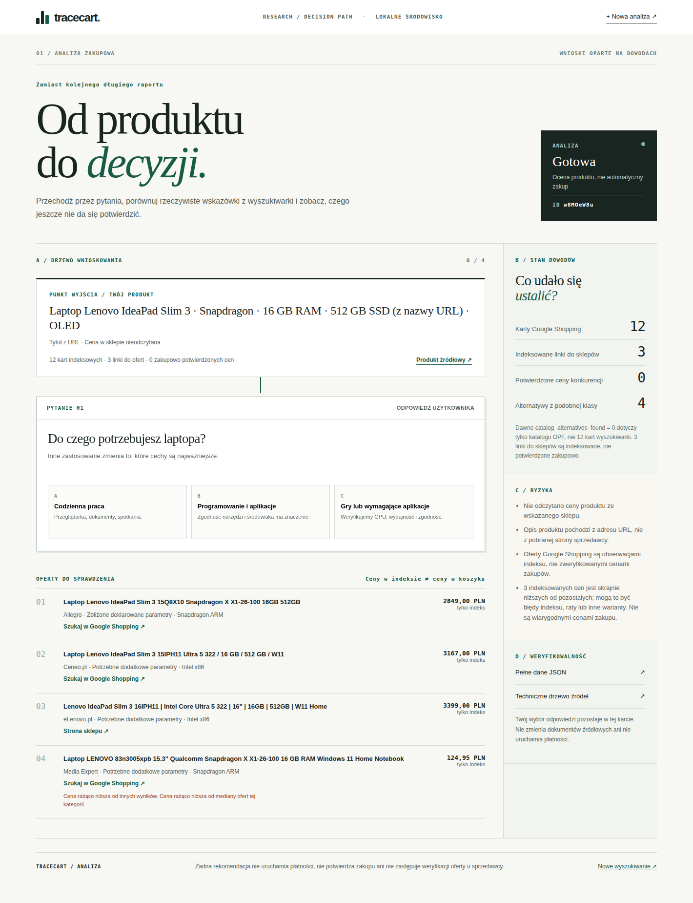
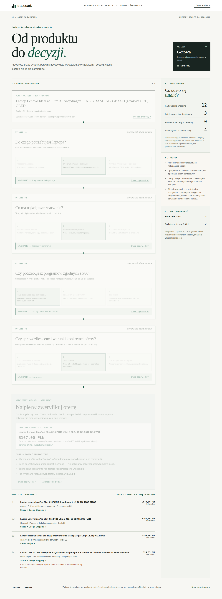

> **CONNECTED OFFER GRAPH (2026-11-03):** New deterministic,
> read-only `/cart/status/<id>.knowledge-graph.json` and interactive
> SVG above the existing decision path. Joins every offer's unverified
> title claims, per-offer V×Ah derived Wh (never a tested battery),
> indexed quote, 24 first-priority evidence gaps, source-linked
> independent review references and abstention gate. On saved e-bike
> job: 13 offers, 10 distinct advertised specs, 12 unverified prices,
> 312 open top-priority links, 0 verified exact SKU. On laptop job:
> 2 distinct measurements from one fetched review, reference-only,
> 0 exact SKU verified. Native browser click, zoom/pan, graph JSON
> export, no third-party graphics libs or Neo4j requirement.
> [Full schema & test results](OFFER_KNOWLEDGE_GRAPH_2026-11-03.md).
>
> **NEXT RESEARCH FIX (2026-11-03):** On actual
> `LoHWENthHlgccaUCtbOdQkCO` e-bike job, removed 288 repetitive
> source-question permutations per offer. Now 24 separate high-priority
> topics + domain-appropriate follow-ups (228 per offer), unverified
> listing-title claims, related search-index model names (NOT exact identity),
> conditional Wh/range arithmetic, and a resilient local Qwen JSON retry.
> Historical Allegro GET remains blocked (HTTP 403), independent e-bike
> tests/prices are not proven. See
> [EBIKE_RESEARCH_FIX_2026-11-03](EBIKE_RESEARCH_FIX_2026-11-03.md).
>
> **LATEST RESEARCH EVIDENCE (2026-11-02):** A separate robots-aware
> independent-source execution worker now verifies fetched page identity,
> methods and results. On the saved Lenovo case it found **2 distinct
> independent test observations** (708 Cinebench 2024 and 19h01 WiFi)
> relevant to 15Q8X10 **IPS reference** only; no exact x-kom OLED MTM or
> seller checkout price is verified. Results are separately stored; original
> audit is unchanged. See [EVIDENCE_EXECUTION_2026-11-02](EVIDENCE_EXECUTION_2026-11-02.md).
>
> **LATEST CHANGE (2026-11-02):** The no-click research tree now appears
> immediately while source retrieval or Qwen is running. For the saved Lenovo
> example: 16 listing leads, 288 *planned* source checks per offer, 4608 total.
> Qwen separately proposes further questions per offer **after READY**, without
> blocking the page. These are open plans, **not verified answers**. See
> [PROGRESSIVE_OFFER_RESEARCH_2026-11-02](PROGRESSIVE_OFFER_RESEARCH_2026-11-02.md).
>
> This historic handoff predates that change.

# AKTUALIZACJA PO HANDOFF — 2 listopada 2026, etap autonomicznych pytań

**Ten handoff opisuje bazowy stan przed kolejnym etapem.**
Nowy, zweryfikowany etap opisuje dokument
[AUTONOMOUS_EVIDENCE_2026-11-02.md](AUTONOMOUS_EVIDENCE_2026-11-02.md).

Frontend `/cart` i `/cart/status/{id}` jest po angielsku. Użytkownik
podaje wyłącznie URL; nie klika odpowiedzi. LLM Qwen po wynikach
Shopping potrafi wygenerować cztery pytania do źródeł (realny lokalny test;
pierwszy cold-start zakończył się timeoutem). Odpowiedzi mogą pozostać
OPEN, a nie być zmyślane. Historyczny raport nie jest edytowany.
Dla Lenovo dodano PSREF 15Q8X10 i 16IPH11 oraz niezależne badania
Notebookcheck **różnych konfiguracji** — bez przypisywania wyników
IPS/60 Wh wariantowi OLED i bez traktowania Core 5 210H jako
Core Ultra 5 322. Stan: 375 testów Python, 8 Node i realny headless Chromium
na kopii zachowanego zadania. Otwarta blokada: brak zweryfikowanego
checkout, pełnego collectora testów, sandboxowego E2E PayPal oraz filmu/Devpost.

---

# TraceCart — stan i przekazanie prac, 2 listopada 2026, 21:45 CET

**Cel:** następny czat ma móc kontynuować pracę samodzielnie, bez odtwarzania poprzedniej wielogodzinnej rozmowy. Ten dokument odróżnia stan sprawdzony od planów.

## A. Repozytoria, cele i oczekiwania

- Publiczne główne repo: https://github.com/issueslinux/tracecart
- Kopia projektu w Hunter: https://github.com/issueslinux/hunter, pod ścieżką **competitions/paypal_ai_2026/tracecart/**. Zadanie konkursowe: https://github.com/issueslinux/hunter/issues/55.
- Projekt: AI-asystent zakupowy dla **PayPal AI Hackathon 2026**, z bezpiecznym PayPal Sandbox i bez możliwości samoczynnego autoryzowania zakupów.
- Kluczowe decyzje użytkownika: **jeden URL → wyszukanie ofert i alternatyw → pytania i odpowiedzi → uzasadniony, warunkowy wniosek**. Dopuszczone są różne marki i modele podobnej klasy, nie tylko identyczne SKU.
- Allegro i inne marketplace są krytyczne; kiedy ich strony odrzucają automatyczne pobieranie (np. HTTP 403), wyszukiwarka może dostarczyć wskazówki **niepotwierdzone**. Nie próbować obchodzić blokad.
- Użytkownik nie chce ciemnego, przewijanego „AI slop” z surowymi polami JSON na końcu. Domyślnie ma widzieć **jasne, dynamiczne drzewo decyzji** z pytaniami, a audyt techniczny osobno.
- Preferowany sposób pracy: analiza → implementacja → prawdziwa weryfikacja → testy → commit/PR → merge. Bez GitHub Actions. Github jako główny kanał, Desktop Commander tylko do niezbędnej kontroli lokalnej. Bez ciągłego pytania o zgodę, bez zgadywania, bez pustej pętli testów.

## B. Wykonane i scalone (stan sprawdzony 2026-11-02)

**TraceCart PR #47:** https://github.com/issueslinux/tracecart/pull/47 — MERGED, SHA **0cc9731484d24d9ee4d5a192b2f4bfe09f854bc9**.

**Hunter PR #144:** https://github.com/issueslinux/hunter/pull/144 — MERGED, SHA **4d88c01ab2208bcbdc0c6fe537f7d04d9e983a2b**.

Działa:

1. Nowa strona **/cart** z pojedynczym adresem produktu.
2. Formularz wysyła POST i przekierowuje HTTP 303 bezpośrednio na **/cart/status/{id}**. Nie wymaga kolejnego kliknięcia ani nie ponawia POST podczas odświeżenia.
3. **/cart/status/{id}**: interaktywne drzewo z progresywnym rysowaniem; samoczynnie odpytuje status zapisanej analizy, pokazuje informacje o produkcie, kolejne pytania, odpowiedzi i warunkową konkluzję. Użytkownik może edytować wcześniejsze odpowiedzi i zresetować ścieżkę. Odpowiedzi zmieniają ranking, ale nie modyfikują danych źródłowych.
4. Dla laptopów porównywane są informacje o **RAM, pojemności dysku, procesorze ARM/x86, OLED/IPS i rozmiarze ekranu**, jeżeli są rzeczywiście podane. Przy wymaganej zgodności x86 kandydaci ARM są odfiltrowani.
5. Dla rowerów elektrycznych i innych obsługiwanych kategorii podobne modele różnych producentów mogą być alternatywami.
6. Panel dowodów rozdziela **katalog Open Products Facts, karty Google Shopping, indeksowane linki do sklepów, ceny faktycznie potwierdzone**.
7. **/cart/status/{id}.decision.json** — nowa odczytowa projekcja na podstawie starego raportu.
8. **/cart/status/{id}.json** — oryginalny zapisany raport, bez zmian hash.
9. **/cart/status/{id}/audit** — stare pełne drzewo krytyka i źródeł, z wyjaśnieniem liczników.
10. CSS/JS są lokalne, ograniczone polityką CSP, bez zewnętrznych fontów i śledzenia. Nie ma automatycznej autoryzacji płatności.

Wcześniejsze PR-y: TraceCart #45 i Hunter #141 (porównywanie podobnej klasy), TraceCart #46 i Hunter #142 (Python 3.8 socket.timeout przy nieosiągalnym sprzedawcy).

**Ważne ograniczenie:** nowe drzewo jest na dziś **nawigacją poprzez pytania z rozgałęzieniami i zmianą wyniku**, nie w pełni autonomicznym agentem, który w każdej gałęzi odkrywa nowe fakty. Nie przedstawiać takiego agenta jako już zbudowanego.

## C. Wyjaśnienie problemu Lenovo: skąd zera i jakie są fakty?

Dokładny wynik: http://127.0.0.1:8781/cart/status/w8MOeW8uE7pCqDYKf48-lXxy

Wejście: URL laptopa x-kom Lenovo IdeaPad Slim 3, Snapdragon X1-26-100, 16 GB RAM, 512 GB, OLED. Obecna etykieta opisuje **informacje odczytane z URL**, a nie potwierdzone przez sklep.

Pobranie HTML x-kom zostało zatrzymane: **SOURCE_TOO_LARGE**. Z tego powodu **cena oryginalnej oferty jest nieznana**. Nie wolno zamieniać null na 0 zł.

| Rzeczywista liczba w zachowanym raporcie | Wynik |
|---|---:|
| Produkty w katalogu OPF (stare catalog_alternatives_found) | **0** |
| Karty Google Shopping | **12** |
| Indeksowane linki do sklepów | **3** |
| Łącznie obserwacje z indeksu | **15** |
| Alternatywy zakwalifikowane na podstawie dostępnych opisów | **4** |
| Skrajnie niskie kwoty w indeksie | **3** |
| Ceny konkurentów potwierdzone w koszyku lub u sprzedawcy | **0** |
| Cena produktu źródłowego w x-kom | **nieodczytana** |

Stare pole catalog_alternatives_found mierzyło **wyłącznie katalog OPF**, a nie Google Shopping. Dawne unit_economics (cost_per_wash) dotyczy detergentu, nie laptopa. Wyszukiwarka miała ceny 124,95 PLN i 169,95 PLN oraz 399 PLN w ofercie z abonamentem; **nie mogą być traktowane jako potwierdzone okazje**.

**Rzeczywisty test Chromium na zapisanym zadaniu**:

- Programowanie → kompromis → wymagane x86 → cena niesprawdzona: wskazówka z indeksu Ceneo **3167 PLN (Intel)**, tylko do weryfikacji.
- Zmiana gałęzi na „ARM akceptowalny”: wskazówka z indeksu Allegro **2849 PLN (Snapdragon)**, również bez potwierdzenia ceny zakupu.
- Cofnięcie odpowiedzi usuwa następne węzły, reset rozpoczyna od nowa. W przeglądarce nie było błędów JS.

Dowody: [zredukowany rzeczywisty raport](../examples/live_lenovo_ideapad_index_evidence_2026-11-02.json) i [nowa projekcja](../examples/live_lenovo_ideapad_decision_projection_2026-11-02.json).

Zrzuty rzeczywistego interfejsu:

## D. Środowisko, uruchomienie i testy

Host użytkownika: **hexagony-01**, Ubuntu 20.04, **Python 3.8.10** i Node.js. Lokalna kopia projektu:

    /mnt/nvme_fast/hunter/competitions/paypal_ai_2026/tracecart

Przy zamknięciu tej sesji działa aplikacja:

    http://127.0.0.1:8781/cart

Serwer jest przypięty do **127.0.0.1**, nie jest publicznie dostępny poza hostem. Test dostępności bez restartu:

    curl -fsS -o /dev/null -w '%{http_code}\n' http://127.0.0.1:8781/cart

Jeżeli proces nie działa i port jest wolny, uruchom ręcznie (nie startuj drugiej instancji na zajętym porcie):

    cd /mnt/nvme_fast/hunter/competitions/paypal_ai_2026/tracecart
    set -a
    source "$HOME/.config/tracecart/serpapi.env"
    set +a
    python3 -u app.py --port 8781 --db /tmp/tracecart-serpapi-e2e-20261102.sqlite3

Dane uwierzytelniające SerpApi są **prywatne** w pliku konfiguracyjnym hosta (uprawnienia 0600). Nie drukuj, nie ujawniaj, nie commituj ich. BRAVE_API_KEY nie jest tym samym kluczem co SERPAPI_API_KEY. **Nie zużywaj limitu SerpApi na powtarzanie tego samego testu**, skoro są zapisane wyniki offline.

Baza SQLite pod **/tmp/** nie jest trwałym magazynem — możliwe czyszczenie po restarcie/konserwacji. Nie usuwaj jej i nie sugeruj, że historyczny link jest publiczny czy trwały.

Testy lokalne:

    cd /mnt/nvme_fast/hunter/competitions/paypal_ai_2026/tracecart
    python3 -m unittest discover -s tests -q
    node --test tests/test_decision_flow_logic.cjs

Ostatnio potwierdzone: **369/369 Python**, **9/9 Node** oraz rzeczywisty scenariusz Chromium (pytania, gałęzie ARM/x86, cofanie/reset, zero błędów JS). Testy jednostkowe nie są potwierdzeniem realnej ceny w sklepie.

**Ważna pułapka repo Hunter:** nieśledzony katalog **data/solver-demos/** należy do innej pracy — **nie dodawać, nie usuwać, nie modyfikować**.

## E. Co nadal nie działa / czego nie twierdzić

- HTML Allegro nadal może zwracać **403**; x-kom w powyższym przypadku przekroczył limit rozmiaru. Nie omijaj robots.txt, ochrony antybotowej, CAPTCHA ani uwierzytelnienia.
- SerpApi Google Shopping zwraca **obserwacje indeksu**, nie zweryfikowane ceny koszyka, dostępność, koszty wysyłki czy dokładny model.
- **Brak niezależnych testów jakości w powyższym zadaniu.** Wynik 82/100 to heurystyczna zgodność cech tytułów, nie test procesora, baterii, matrycy, termiki ani reputacji sprzedawcy.
- Kliknięcie „sprawdziłem cenę” jest **deklaracją użytkownika**, nie weryfikacją przez TraceCart. Rezultat pozostaje warunkowy.
- Brak realnego potwierdzenia end-to-end PayPal Sandbox OAuth → order → approval (system jest sandbox-only). **Nie prowadzić prawdziwych płatności ani automatycznych ponowień**.
- Nie ma dowodu ukończonego zgłoszenia Devpost, filmu i publicznego demo. Termin w README: **12 listopada 2026, 21:00 CET**; sprawdzić obowiązujący regulamin, zanim się zgłosi.

## F. Co robić dalej — priorytety

### P0: twarde źródła o jakości i porównywalności

Najbardziej wartościowa następna implementacja: **odnajdywanie i włączanie niezależnych dowodów** o konkretnym produkcie i alternatywach, a nie kolejne kosmetyczne zmiany UI.

Dla Lenovo Snapdragon z pierwotnego linku i co najmniej jednej porównywalnej alternatywy Intel znajdź legalnie dostępne specyfikacje **producenta/OEM**, następnie autentyczne niezależne testy/reviews (zgodność ARM/x86, wydajność, ekrany, baterie, termika, gwarancja). Rozróżniaj dokładne SKU i warianty. Zapisuj **URL, wydawcę, datę, metodę, pomiar/claim, zakres pewności, wykryte różnice i brakujące dane**. Bez wiarygodnego niezależnego źródła wynik ma pozostać nieznany.

**Oczekiwany realny efekt:** w analizie konkretnego laptopa pokaże się nowa, prawdziwie źródłowa informacja, która pozwala lepiej rozstrzygnąć konkretny kompromis. Potrzebne testy i E2E na istniejącym wyniku.

### P0: aktualność i znaczenie cen marketplace

Sprawdzaj, czy niska kwota jest pełną ceną, ratą, abonamentem, produktem używanym czy innym wariantem. Nie awansuj obserwacji indeksu do potwierdzonej ceny. Legalny search/API/merchant feed jest dopuszczalny; omijanie 403 niedopuszczalne. Najpierw używaj offline snapshots, potem małych realnych kontroli.

### P0: przygotowanie zgłoszenia konkursowego

Czas do terminu jest ograniczony. Zweryfikuj stan PayPal Sandbox, demo dla jury, wideo i Devpost. **Bez gotowego legalnego klucza sandbox nie udawaj testu prawdziwej autoryzacji.** W żadnym etapie nie naruszaj bariery AI/płatność.

Nie poświęcaj całej nowej iteracji na formatowanie, parsery kosztów dostawy i powtarzanie istniejących testów bez rezultatu badawczego.

## G. Mapa plików

| Zagadnienie | Pliki |
|---|---|
| HTTP, formularz, status, CSP | app.py |
| Zadania, lokalny raport | cart_research.py |
| Odczytowa projekcja do dynamicznego UI | guided_decision.py |
| Heurystyczna podobna klasa | similar_tier.py |
| Google Shopping i dostępne linki | search_first.py |
| Czytnik URL, SSRF/robots i pobieranie strony | product_intake.py |
| Rekonesans ofert przez dopuszczone wyszukiwarki | automatic_offer_discovery.py |
| Starsze kompletne drzewo dowodów/krytyka | decision_tree.py |
| Renderowanie wyborów i zmiana gałęzi | assets/decision-flow.js |
| Projekt graficzny | assets/decision-flow.css, assets/decision-entry.html |
| Testy | tests/test_http.py, tests/test_guided_decision.py, tests/test_decision_flow_logic.cjs |
| Szczegóły zakończonej przebudowy | docs/INTERACTIVE_DECISION_TREE_2026-11-02.md |
| Porównywanie podobnej półki | docs/SIMILAR_PRODUCT_TIER_2026-11-02.md |
| SerpApi na 20 produktach | docs/SERPAPI_LIVE_20_RESULTS_2026-11-02.md |

Otwarte issues: [#38 — marketplace](https://github.com/issueslinux/tracecart/issues/38),
[#43 — Shopping/ranking](https://github.com/issueslinux/tracecart/issues/43),
[#2 — niezależne dowody](https://github.com/issueslinux/tracecart/issues/2).

**Gotowa pierwsza wiadomość do nowego czatu:**
[NEW_CHAT_START_PROMPT_2026-11-02.md](NEW_CHAT_START_PROMPT_2026-11-02.md).

W przyszłości aktualizuj ten dokument **po faktycznej implementacji**
wraz ze źródłami, PR, wynikami testów i otwartymi ryzykami.
